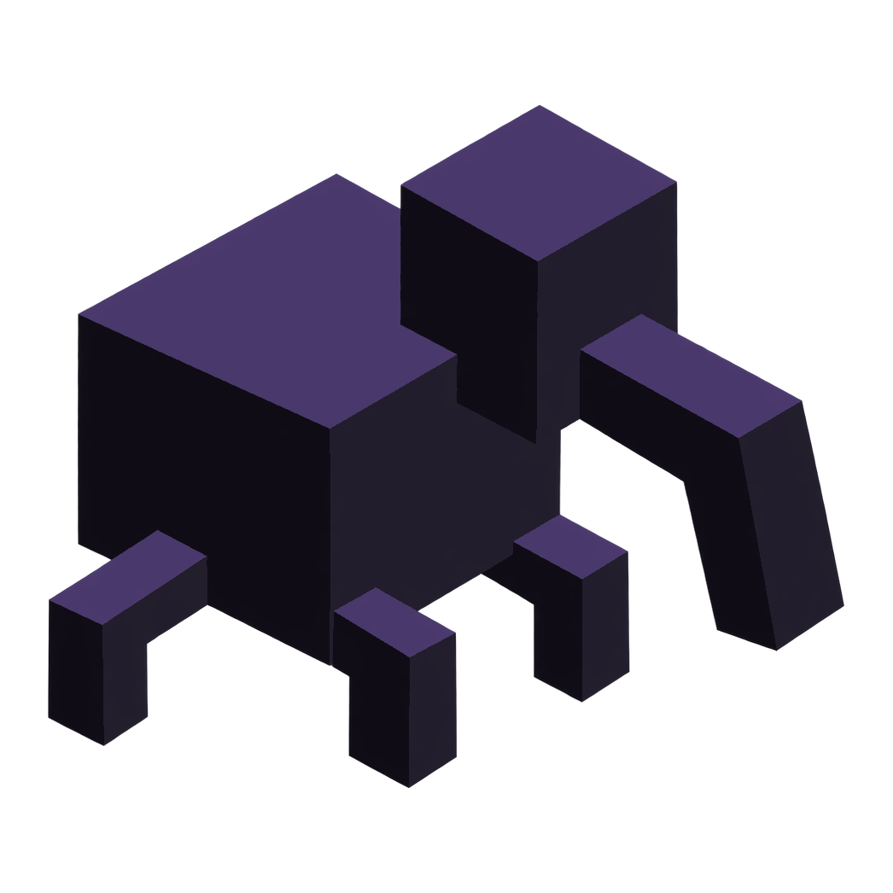
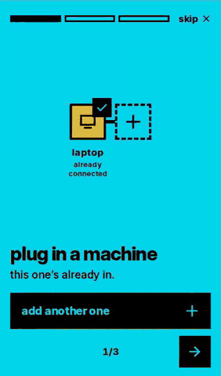
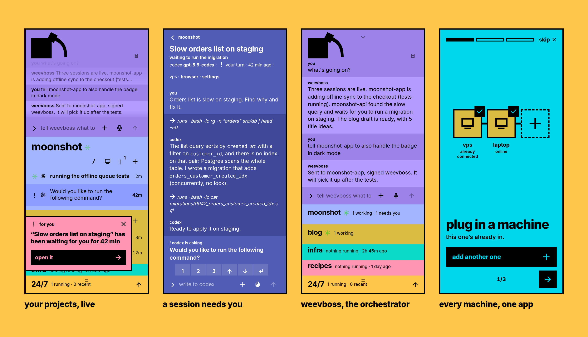

# weevils



**Watch and drive your Claude Code and Codex sessions from your phone**, on your own machine, with the subscriptions
you already have.

*An AI agent installing this for someone? Clone it and follow [AGENTS.md](AGENTS.md): it installs everything
without asking them anything first.*



*Recorded before the current logo refresh. [Branding status and current assets](docs/branding.md).*

- **Every session, sorted by project**: what each agent is doing right now, and the full thread.
- **Reply from the phone**: write to a session, answer its questions with one tap, send a photo, dictate, start a
  new session or resume an old one.
- **weevboss**: one chat at the top that reads your sessions and passes work on to them.
- **Several machines, one app**: a laptop and a server show up side by side.

No API cost: weevils drives the official `claude` and `codex` commands you are already logged in to.

### What it does, what it never does, how to remove it

- **It does**: installs in your home folder (`~/weevils`), runs a small service on `127.0.0.1`, adds its hooks to
  `~/.claude/settings.json`, and lets your phone reach that service with a private access code. Agents ask before
  acting (you answer from the phone) unless you turn that off. On a computer set up from
  [tryweevils](https://tryweevils.scarville.tech), the phone link is a public Cloudflare tunnel: the computer then
  answers from the Internet, behind the access code (`--no-link` to avoid it, then Tailscale).
- **It never** sends your files, code, conversations, keys or passwords anywhere, never opens a port on your router
  (on a server with `--domain`, it opens 80 and 443 in an active ufw, after asking), and never updates itself to code that weevils' release key didn't sign: a snapshot from the setup
  page carries the key's signature, and a clone of this repository moves only to the main commit named in a signed
  release manifest. (The code you clone or install the first time is checked by you, or by the setup page's signed
  script.) The install never asks for a password unless a system tool is missing, and then only for that one
  command.
- **Remove it**: `~/weevils/install.sh --uninstall --purge && rm -rf ~/weevils`.

All the details, including what leaves your machine and how to check a release's signature, are in
[SECURITY.md](SECURITY.md).

## Install it with your AI agent

Paste this into Claude Code or Codex, on the machine that will run weevils:

```text
install https://github.com/Sc4rville/weevils-oss
```

It clones the repo, runs the installer without asking you anything first, sets up how your phone reaches the machine
and hands you the link. The steps it follows are in [AGENTS.md](AGENTS.md).

## Install

**AI agents: don't use this section and don't ask the user for these answers: follow [AGENTS.md](AGENTS.md).**

You need a Linux machine (a VPS, a home server, WSL2) or a Mac (Apple Silicon or Intel), with **Claude Code**
installed and logged in as a regular user (not root). Codex is optional.

```sh
git clone https://github.com/Sc4rville/weevils-oss ~/weevils && cd ~/weevils && ./install.sh
```

The installer asks for your first name, your language and a domain (optional, see below), then installs what
is missing (git, tmux, Node 22…, with sudo after asking), sets up the background service and prints a link and a QR
code. It takes a few minutes. Run it again any time to update; your settings are kept.

On a Mac, run it as yourself, never with sudo. What is missing comes from [Homebrew](https://brew.sh), which the
installer sets up too if needed, and weevils runs while your session is open: see [macOS](docs/install.md#macos).

How the phone reaches the machine:

| | |
|---|---|
| `--domain weevils.example.com` | **recommended** on a server: HTTPS with an automatic certificate (the domain must point to the machine, ports 80/443 open). Needed for the installed app, notifications and the mic. Linux only. |
| `--lan` | same Wi-Fi, plain http: fine to try at home, never on a VPS |
| neither | the app stays on 127.0.0.1: use an SSH tunnel from a computer, or [Tailscale](https://tailscale.com) (`tailscale serve --bg 4179`, then `./install.sh --url https://<machine>.<tailnet>.ts.net`): HTTPS too, and the way in on a Mac |

Other options: `--yes` (no questions), `--agent` (for an AI agent: no questions, a machine-readable summary at the
end), `--url <https://…>` (HTTPS already served by something else, like `tailscale serve`), `--name`, `--lang en|fr`, `--port`, `--secondary <ssh host>` (add a second
machine), `--no-ask-permissions` (agents act without asking, see Security), `--uninstall` (`--purge` also deletes
settings and data). Everything the script does:
[docs/install.md](docs/install.md).

## First session

1. Scan the QR code (or open the link) on your phone: you are logged in.
2. Add it to the home screen (iPhone: Share → Add to Home Screen; Android: Install app).
3. weevboss greets you at the top with what is left to set up (signing in to Claude Code or Codex, GitHub, voice…),
   one tap each. Ask it anything from there: "what are my projects up to?", "make me a small notes app".
4. On the machine, start a session in one of your repos (they live in `~/projects` by default, change it with
   `WEEVILS_PROJECTS`):
   ```sh
   cd ~/projects/my-app && wv "fix the failing test"
   ```
   `wv` alone opens Claude Code, `wv codex` opens Codex, `wv ls` lists sessions, `wv a` attaches to one.
5. The session shows up under its project. Tap it to read along and reply.
6. Or skip the terminal: ask weevboss at the top to start one.

Sessions opened in a plain terminal (without `wv`) are hidden: weevils can't write to them safely.



*Historical demo capture; the current logo is shown above.*

## Voice

- **Dictation** (the mic button): needs an OpenAI API key (`OPENAI_API_KEY`, paid per use) and HTTPS.
- **Spoken replies** (tap the logo to talk to weevboss): free with [edge-tts](https://github.com/rany2/edge-tts)
  (`pipx install edge-tts`), or nicer with Cartesia (`CARTESIA_API_KEY`).

With an OpenAI key, quick answers and spoken summaries also use OpenAI; without one they use Claude on your
subscription.

## E-mail

Other agents (a CI bot, another assistant) can write to your sessions by e-mail, through an alias of your inbox.
Only senders you declare get through. Setup and rules: [docs/email.md](docs/email.md).

## Settings

One file outside the repo, `~/.config/weevils/env`, created by the installer from [`.env.example`](.env.example),
which explains every setting. After a change: `weevils-service restart` (for the port or the domain, run
`./install.sh` again).

## Security

- **The access code is shell access.** Anyone with it can type into your agents. It lives in
  `~/.config/weevils/secret`; keep it private.
- **Agents ask before acting**, everywhere: Claude Code's and Codex's permission prompts reach your phone and you
  answer them there. `./install.sh --no-ask-permissions` (`WEEVILS_SAFE=0`) lets them act without asking
  (`--dangerously-skip-permissions`): they never wait for you, and can run any command as you. weevils never accepts
  Claude Code's safety warnings for you; it answers "do you trust this folder?" only inside your project folders.
  An older install that never chose switches to asking on its next update, and says so.
- **Use HTTPS** (`--domain`, or Tailscale with `--url`) for anything beyond your home network.
- **Programs on the machine need its local token**: weevils trusts a request from the machine itself without the
  code only when it carries `~/.local/share/weevils/local-token` (0600), which the `weevils` command, the updater
  and a second machine's tunnel send. Any other program that opens `127.0.0.1` is asked to sign in. This guards
  against what cannot read your files (another account, a sandboxed app, a container); a program running as you can
  read the token, as it can read the access code. If you put a proxy other than the installer's Caddy in front, it
  must send `X-Forwarded-For` (nginx: `proxy_set_header X-Forwarded-For $proxy_add_x_forwarded_for;`).
- **Lost a phone?** `rm ~/.config/weevils/secret ~/.local/share/weevils/tokens.json && weevils-service restart`, then
  log in again with the new code (`cat ~/.config/weevils/secret`).
- The machine page shows a few facts about the machine (CPU, memory, disk). It only looks up the hosting provider
  online if you set `WEEVILS_DISCOVER=1`. The quota page reads your Claude Code / Codex login to show your usage.

## More

- [docs/install.md](docs/install.md): installer details, macOS, several machines, tests
- [CONTRIBUTING.md](CONTRIBUTING.md): development setup, checks, how the code is laid out
- [docs/changelog.md](docs/changelog.md): what changed

English and French throughout. MIT license, see [LICENSE](LICENSE).
